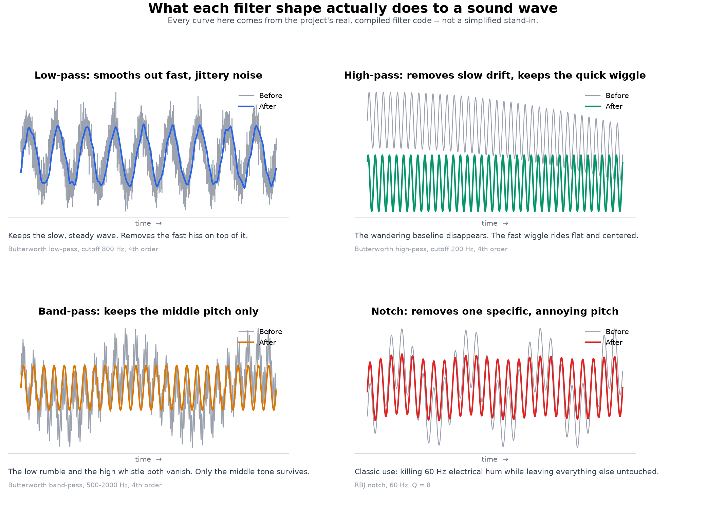
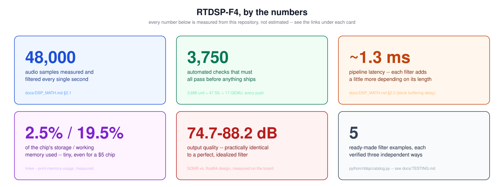
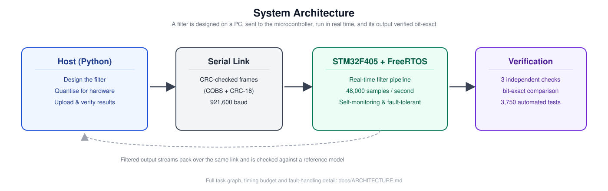
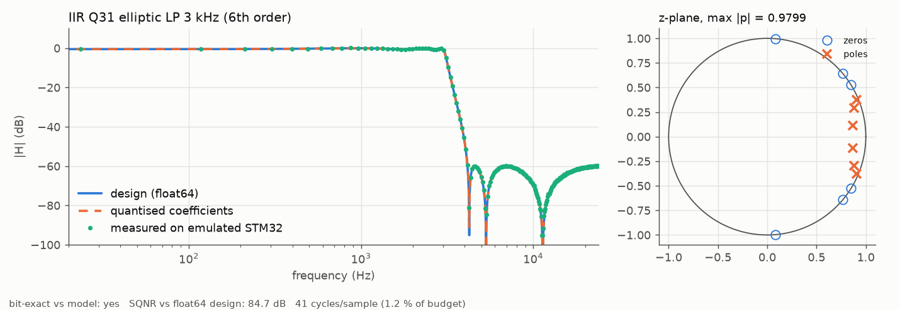

# RTDSP-F4: real-time DSP filtering on an STM32F405 with FreeRTOS

[](https://github.com/IbanCoulibaly/rtdsp-f4/actions/workflows/ci.yml)
[](LICENSE)

## What is this, in plain English?

This project takes a wobbly signal — sound, really, but it could be any
electrical signal that wiggles up and down — and cleans it up in real time,
on a microcontroller the size of a fingernail that costs about $10.

A **filter** is a set of rules about which "speeds of wiggle" (engineers call
this *frequency*) get let through, and which get blocked. This project builds
four classic kinds of rules:

| Filter | What it lets through | Everyday example |
|---|---|---|
| **Low-pass** | slow wiggles only | smoothing out hiss or static |
| **High-pass** | fast wiggles only | removing a slow drifting bias |
| **Band-pass** | wiggles in one middle range | isolating a voice from rumble and whistle |
| **Notch** | everything *except* one exact speed | killing 60 Hz electrical hum |

Here's what each one actually does to a real signal, measured straight off
this project's own filter code (not a simplified stand-in):



### Is it any good?



In short: it runs fast enough for real audio, uses a tiny sliver of the
chip's memory, and — unusually for a hobby-scale project — every single
output sample is checked, automatically, against what a perfect mathematical
filter should have produced. Nothing above is a marketing estimate; every
number links to exactly where it comes from in this repository.

**That's the whole pitch.** Everything from here down is the engineering
detail behind it, for anyone who wants to see how it actually works.

---

Design a digital filter in Python, quantise it for a microcontroller, upload
it over a framed serial protocol, and run it in real time under FreeRTOS on
an emulated STM32F405 (Cortex-M4F, QEMU `netduinoplus2`). Then prove
that the board's output is **bit-identical** to a reference model.

```
Python: design ─► quantise ─► upload ─► stream ─► verify (bit-exact) ─► report
                                 │                  ▲
                     COBS + CRC-16 over USART1      │
                                 ▼                  │
STM32F405 / FreeRTOS:  link_rx ─► DSP task (FIR / biquad, Q15 · Q31 · f32) ─► link_tx
                                    ▲
                     sample-clock ISR (NCO + noise), zero-copy block pool
```



The diagram above is the detailed version of the ASCII sketch: the four-stage
host pipeline, every FreeRTOS task/ISR and its priority, the ping-pong
coefficient banks and lock-free block pool, the fault-handling path, and the
three-way (Python / SIL / PIL) bit-exact verification loop that closes it.

## What's in it

| Area | What's implemented |
|---|---|
| **DSP** | FIR (Q15, f32) with a mirrored circular buffer; biquad cascades in DF1 Q31 (64-bit accumulator, post-shift) and DF2T f32; saturation and rounding everywhere; on-target stability check |
| **RTOS** | FreeRTOS V11, static allocation only, 5 tasks at rate-monotonic priorities, queues, stream buffers, event groups, ISR→task hand-off, bounded waits throughout |
| **Real-time design** | zero-copy block pool, data and control in one FIFO (commands land on exact block boundaries), ping-pong coefficient banks for glitch-free updates, hot data in CCM RAM |
| **Robustness** | fault handlers with a crash record that survives reset, assert/stack-overflow hooks, software heartbeat watchdog plus IWDG, power-on self test against golden vectors, timer-clock self-calibration |
| **Bare metal** | own startup code, vector table, linker script and register map (static-asserted), no vendor HAL, no newlib, `-Werror` |
| **Protocol** | COBS framing, CRC-16/CCITT, versioned messages, sliding-window flow control, a C header as the single source of truth with a Python contract test |
| **Verification** | C unit tests with sanitizers, software-in-the-loop via ctypes, processor-in-the-loop on QEMU, requirements traceability ([docs/TESTING.md](docs/TESTING.md)) |
| **Python** | filter design (Butterworth/Chebyshev/elliptic/notch/Kaiser FIR), quantisation with overflow proofs and L∞ scaling, bit-exact models, board driver, demo report |

## Results (from `make demo`)

| filter | kernel | bit-exact on target | SQNR vs float64 design |
|---|---|---|---|
| FIR low-pass 5 kHz, 89 taps (Kaiser 60 dB) | Q15 | yes | 74.7 dB |
| FIR band-pass 2–8 kHz, 63 taps | f32 | yes | 81.2 dB |
| Elliptic low-pass 3 kHz, 6th order | Q31 biquad ×3 | yes | 84.7 dB |
| Chebyshev-I high-pass 1 kHz, 4th order | f32 biquad ×2 | yes | 85.7 dB |
| Notch 1 kHz, Q = 10 | Q31 biquad | yes | 88.2 dB |



## Quick start

Requirements: `arm-none-eabi-gcc`, `qemu-system-arm`, Python ≥ 3.10.

```bash
brew install arm-none-eabi-gcc arm-none-eabi-binutils qemu        # or: apt install gcc-arm-none-eabi qemu-system-arm
git clone --depth 1 --branch V11.1.0 https://github.com/FreeRTOS/FreeRTOS-Kernel.git third_party/FreeRTOS-Kernel
python3 -m venv .venv && .venv/bin/pip install -r requirements.txt
```

```bash
make test
```

```bash
make demo
```

```bash
make viz
```

```bash
make play
```

```bash
make run
```

`make test` builds everything and runs 64 tests: C unit, SIL and QEMU PIL.
`make demo` writes plots and a report to `build/reports/`. `make viz` opens
two windows per filter: the input on top and the board's output below (as
waveform and spectrum), plus a window with that filter's equations and its
actual on-board coefficients. Arrow keys or Prev/Next switch filters.
`make play` is an adjustable-filter playground: a sine wave plus noise goes
in, and sliders set low-pass/high-pass/gain-only, IIR or FIR, cutoff, order
and gain (click the response plot to move the cutoff). Every change is
redesigned, uploaded and run on the emulated board, with live SNR, output
amplitude, clipping warnings and an optional window with the exact H(z).
`make run` boots the board with the console on stdio and the data link on
`tcp:5555`.

## Repository layout

```
libs/dsp/        portable filter kernels + filter_engine (runs on host and target)
libs/link/       COBS, CRC-16, framing, protocol_defs.h (wire-protocol source of truth)
firmware/
  app/           tasks: dsp, link_rx, link_tx, supervisor, log; POST, fault capture, siggen
  app/generated/ tables generated by python/tools/gen_firmware_tables.py
  bsp/           register map, clocks, USART driver, sample timer, timebase, IWDG
  rtos/          FreeRTOSConfig.h, hooks
  startup/ linker/ libc/
host/            ctypes ABI for software-in-the-loop
tests/unit/      C unit tests
python/rtdsp/    design, quantise, bit-exact models, protocol, device + QEMU drivers
python/tests/    contract, design, SIL and PIL test suites
python/tools/    table generator, end-to-end demo, viewer (visualize.py), playground (playground.py)
docs/            DSP_MATH.md, ARCHITECTURE.md, TESTING.md
```

## Documentation

* **[docs/DSP_MATH.md](docs/DSP_MATH.md)**: every equation used (sampling, Q
  formats, quantisation noise, FIR and Kaiser design, biquads, the stability
  triangle, the post-shift overflow proof, L∞ scaling, the bilinear
  transform, NCO, CRC, RMS scheduling), and exactly where and how often each
  one runs on the board.
* **[docs/ARCHITECTURE.md](docs/ARCHITECTURE.md)**: layers, tasks, ownership
  rules, memory, failure handling, and the QEMU-vs-silicon differences.
* **[docs/TESTING.md](docs/TESTING.md)**: the test pyramid and the
  requirements traceability matrix.

## Notes on the emulator

QEMU is functionally exact but not cycle-accurate, so cycle and CPU-load
figures from QEMU are indicative only. QEMU 11.1's STM32 timer model cannot
generate periodic update interrupts, so the QEMU build derives its sample
clock from SysTick instead (details in ARCHITECTURE.md §7). `make fw TARGET=hw`
builds the same firmware for real silicon: PLL clock tree, DWT cycle
counter, TIM2 sample interrupt, debug commands compiled out. It compiles
cleanly but has not been run on a physical board in this repository.
