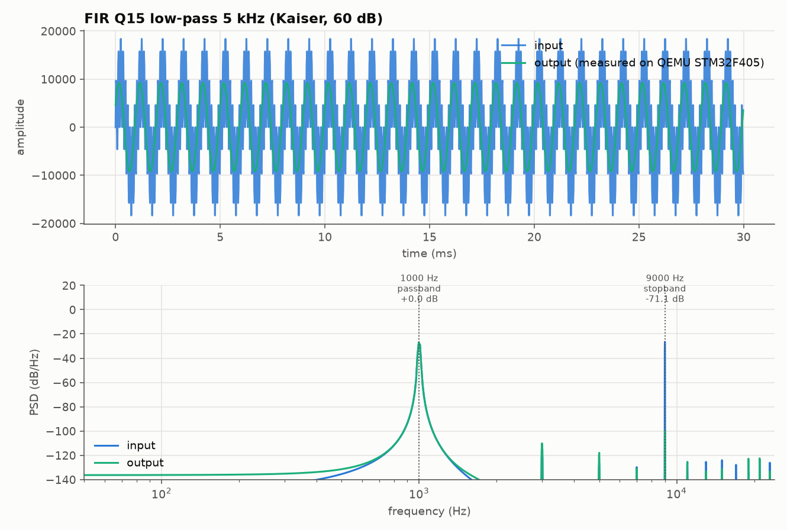
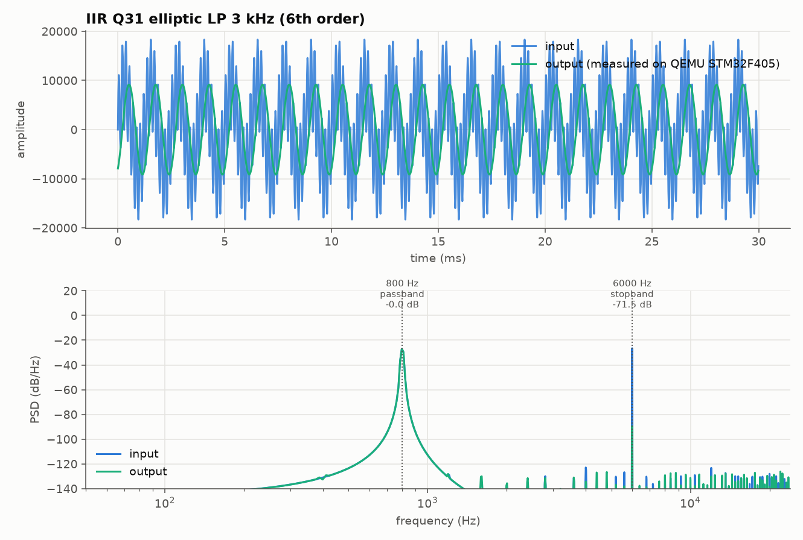
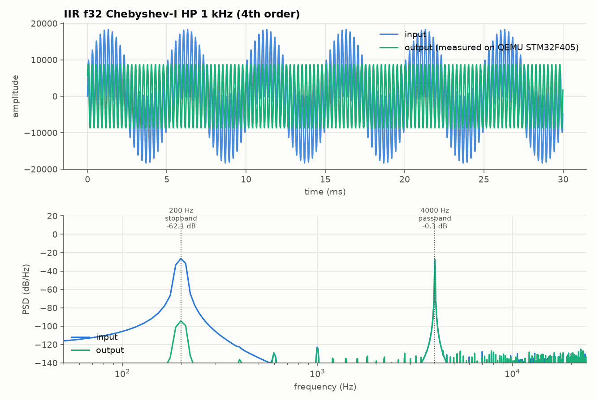
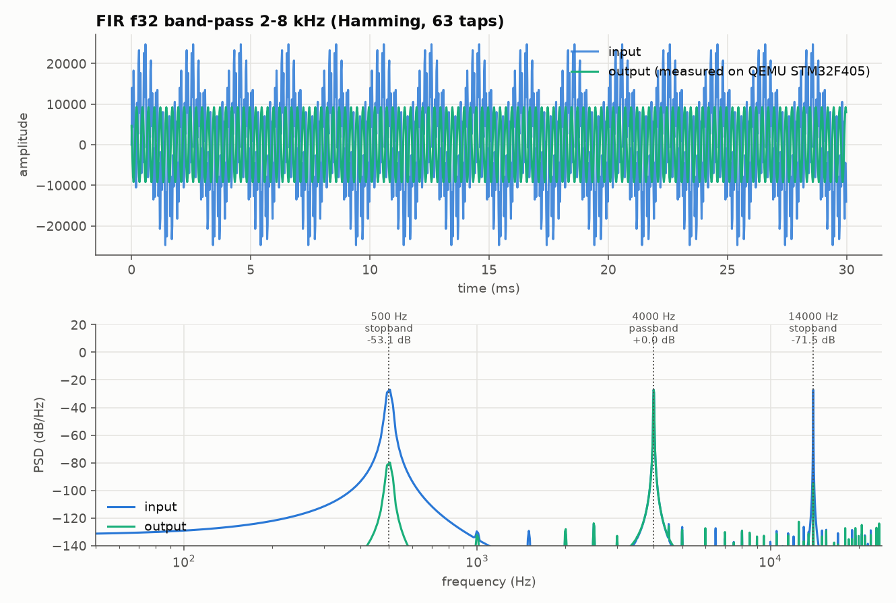
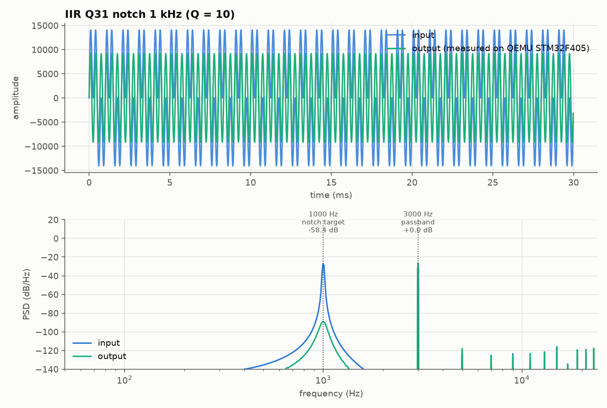

# Filter gallery

Every plot below was produced by `python/tools/gallery.py`: a multi-tone
test signal is uploaded to the real firmware (the same ELF cross-compiled
with `arm-none-eabi-gcc` for the STM32F405) running under QEMU, streamed
through the active filter, and the result is measured back. Nothing here
is computed in Python alone.

Each test signal's frequencies come straight from
[`python/rtdsp/catalog.py`](../python/rtdsp/catalog.py)'s `tones` field --
chosen to straddle that filter's passband/stopband edge, so the effect is
unambiguous: a tone either survives close to 0 dB or is measurably
attenuated.

Regenerate with:

```bash
make fw TARGET=qemu
python python/tools/gallery.py
```

## Low-pass

### FIR Q15 low-pass 5 kHz (Kaiser, 60 dB)



A 5000 Hz low-pass FIR filter (Kaiser window, 60 dB stop-band attenuation target), running in Q15 fixed point -- the format a 16-bit ADC/DAC would deliver directly. Driving it with 1000 Hz, 9000 Hz tones simultaneously: **1000 Hz** (passband) measured at **+0.0 dB**; **9000 Hz** (stopband) measured at **-71.1 dB**. Output matched the bit-exact reference model: **yes**. Measured SQNR against the float64 design: **80.5 dB**.

### IIR Q31 elliptic LP 3 kHz (6th order)



A 3000 Hz low-pass elliptic filter, order 6 (0.5 dB pass-band ripple, 60 dB stop-band attenuation), run as 3 cascaded Q31 biquad sections. Elliptic filters trade pass-band ripple for the steepest possible roll-off at a given order. Driving it with 800 Hz, 6000 Hz tones simultaneously: **800 Hz** (passband) measured at **-0.0 dB**; **6000 Hz** (stopband) measured at **-71.5 dB**. Output matched the bit-exact reference model: **yes**. Measured SQNR against the float64 design: **86.6 dB**.

## High-pass

### IIR f32 Chebyshev-I HP 1 kHz (4th order)



A 1000 Hz high-pass Chebyshev Type I filter, order 4 (1.0 dB pass-band ripple), run as cascaded float32 biquads. Driving it with 200 Hz, 4000 Hz tones simultaneously: **200 Hz** (stopband) measured at **-62.1 dB**; **4000 Hz** (passband) measured at **-0.3 dB**. Output matched the bit-exact reference model: **yes**. Measured SQNR against the float64 design: **86.7 dB**.

## Band-pass

### FIR f32 band-pass 2-8 kHz (Hamming, 63 taps)



A 2000-8000 Hz band-pass FIR filter (Hamming window), run in float32 directly on the samples with no fixed-point quantisation step. Driving it with 500 Hz, 4000 Hz, 14000 Hz tones simultaneously: **500 Hz** (stopband) measured at **-53.1 dB**; **4000 Hz** (passband) measured at **+0.0 dB**; **14000 Hz** (stopband) measured at **-71.5 dB**. Output matched the bit-exact reference model: **yes**. Measured SQNR against the float64 design: **87.0 dB**.

## Notch

### IIR Q31 notch 1 kHz (Q = 10)



A notch filter targeting exactly 1000 Hz with Q = 10 (the classic 50/60 Hz mains-hum remover, retuned here to a more audible frequency for the demo), run as a single Q31 biquad section. Driving it with 1000 Hz, 3000 Hz tones simultaneously: **1000 Hz** (notch target) measured at **-58.4 dB**; **3000 Hz** (passband) measured at **+0.0 dB**. Output matched the bit-exact reference model: **yes**. Measured SQNR against the float64 design: **87.5 dB**.

